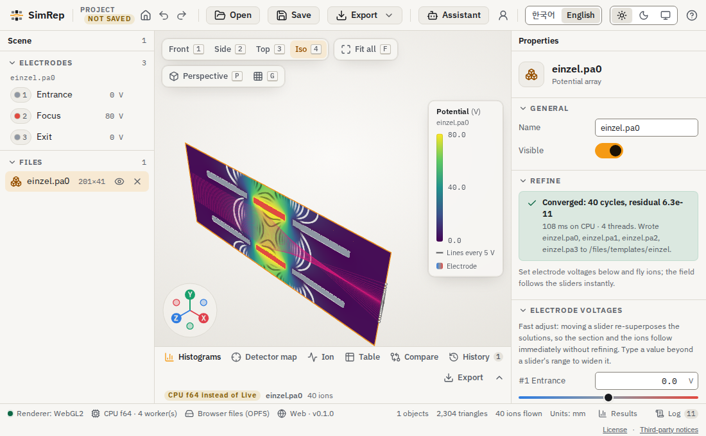
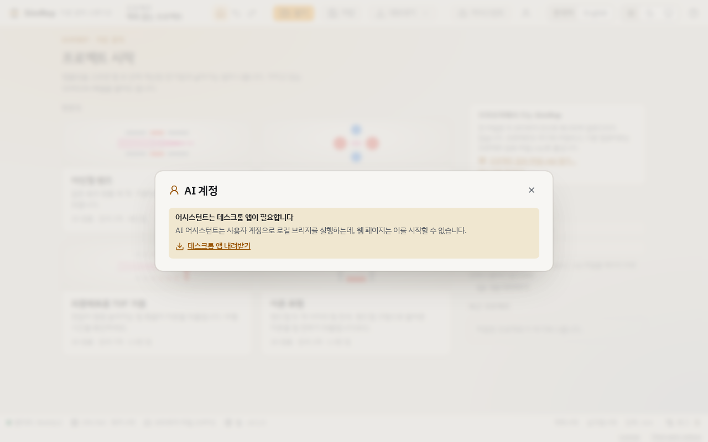
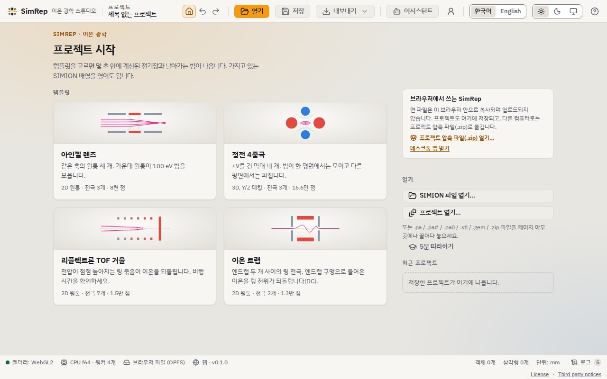
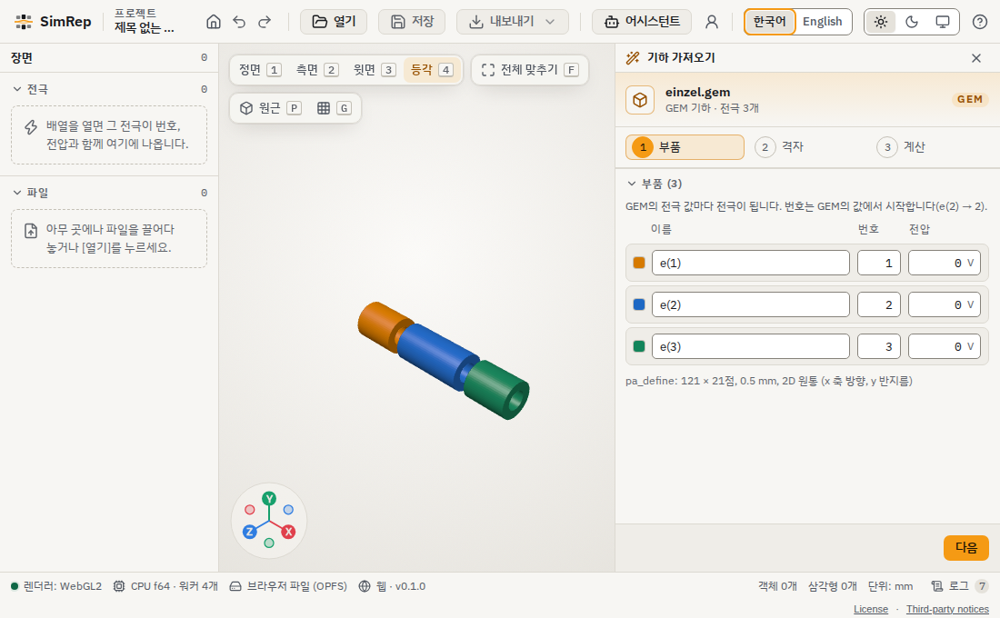
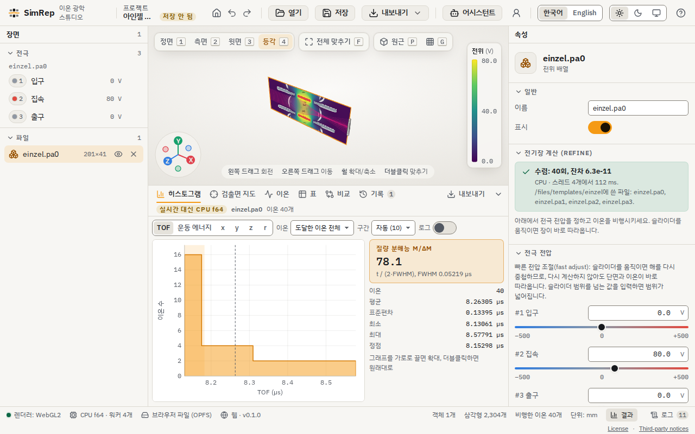
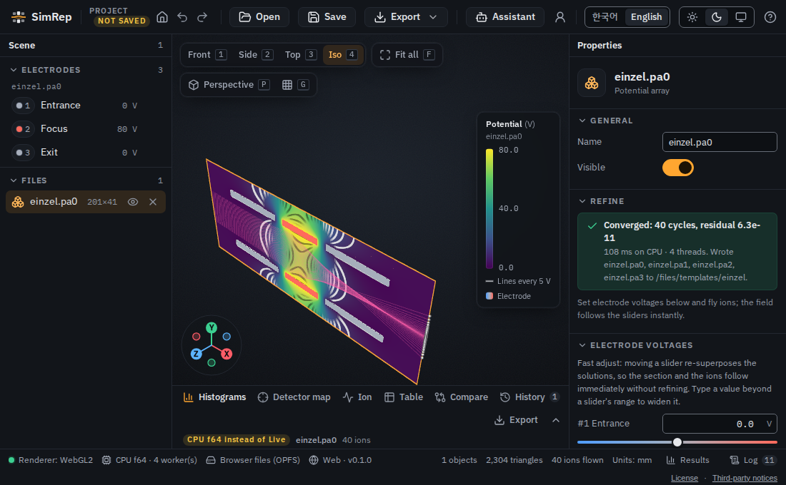
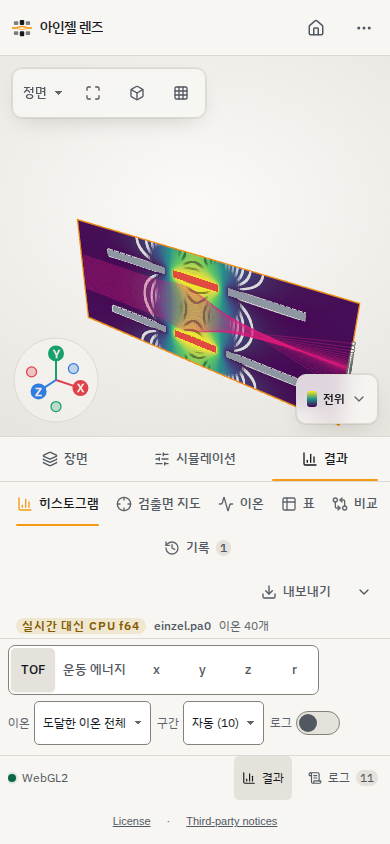

# SimRep-Web

[English](README.md) | [SimRep](https://github.com/leeseunguk/SimRep)

Rust 이온 광학 코어를 브라우저 WebAssembly 워커에서 실행합니다. 형상 생성,
전위 계산, 입자 비행은 계산 서버 없이 로컬에서 수행됩니다.



아인젤 렌즈 템플릿의 전위를 계산하고 이온 40개를 비행한 뒤 렌즈를 화면에 맞춘 모습입니다.
모든 이미지는 빌드된 사이트를 headless Chromium에서 실행해 WebGL2 대체 렌더러로 직접 캡처했습니다.

## 구성과 빌드

`simrep/`은 실제 SimRep 서브모듈이며
`2705fec`로 고정되어 있습니다(휴대폰/태블릿 레이아웃, 터치 조작, WebGL2 대체 경로, 접근성·화면 다듬기, Astra 검토 수정 포함).
`crates/simrep-wasm/`은 계산 래퍼, `app/`은 데스크톱 명령 어댑터,
`web/`은 UI와 IPC 워커입니다. UI 소스의 기본 위치는 `simrep/app/src`이고
개발 시 `SIMREP_APP_SRC`로 바꿉니다. 릴리스 빌드는 깨끗한 고정 서브모듈을 사용합니다.

```sh
git clone --recurse-submodules <repository-url>
cd <checkout>
bash scripts/build.sh
```

Rust는 rustup으로 설치하고 Node.js와 npm도 설치하세요. 직렬 Rust는 1.95.0,
Node.js는 24.14.1로 고정합니다. 스크립트는 wasm32 타깃과 wasm-bindgen-cli
0.2.129를 준비하고 직렬/스레드 wasm 및 UI를 빌드하여 깨끗한 최상위 `dist/`를
만듭니다. 스레드 빌드는 nightly-2025-11-15를 사용합니다.
서브모듈 업데이트, 검증 명령과 정적 호스팅은 [RELEASE.md](docs/RELEASE.md)에 있습니다.

## 기능과 제한

PA/PA#/PA0 및 fast-adjust, 리터럴 GEM과 상대 include/STL, STL/OBJ/PLY/3MF/glTF/GLB,
계단형/정확한 표면 CPU f64 계산, RK45/Boris 비행, ION/리터럴 FLY2,
균일 자기장/자기 PA/코일, 메모리 기반 과학 데이터 내보내기를 제공합니다.
Einzel, quadrupole, reflectron, trap 템플릿과 형상 검사 및 aligned/cut-cell
형상 빌드를 지원합니다. IOB는 경계와 배치를 읽으며 Lua를 실행하지 않습니다.
실행 Lua, STEP/IGES CAD, 결합 공간 전하, 가스 충돌, 네이티브 파일시스템 및
AI 기능은 브라우저에 노출하지 않습니다.



데스크톱 전용 기능은 브라우저에서 사용할 수 없는 이유를 표시합니다.

멀티코어는 최대 4개 Rayon 워커를 사용하며 COOP `same-origin`, COEP
`require-corp`와 HTTPS 또는 localhost가 필요합니다. 격리가 없으면 직렬
패키지의 워커 1개로 대체하고 이유를 보고합니다. 실제 초기화된 개수를 확인하세요.
사용자 지정 헤더가 없는 호스트를 위해 coi-serviceworker도 포함합니다.
WebKit은 중첩 스레드 모듈 워커의 시작/새로고침이 간헐적으로 멈추므로 기본적으로
직렬 패키지의 CPU f64 워커 1개를 사용합니다. WebKit의 명시적 다중 스레드
요청은 실험적이며 지원하는 기본 경로는 워커 1개와 IndexedDB 저장소입니다.

### 템플릿, 형상 가져오기와 결과



템플릿이나 로컬 파일로 시작하며 상태 표시줄에서 실제 워커 수와 저장소를 확인합니다.



실제 `einzel.gem` 파일을 가져온 모습입니다. 다음 단계에서 격자를 만들고 전위를 계산합니다.



입자 궤적과 함께 비행 분포와 통계를 확인할 수 있습니다.



동일한 브라우저 계산과 비행 결과를 어두운 테마로 표시한 모습입니다.

## 브라우저 지원

| 브라우저 | 계산 및 UI | 3D 뷰 | 검증 범위 |
| --- | --- | --- | --- |
| Chrome/Edge | CPU WebAssembly, 최대 워커 4개 | WebGPU 또는 WebGL2 | WebGPU 비활성 Chromium 포함 자동화, Edge 별도 미검증 |
| Safari | CPU WebAssembly, 기본 워커 1개 | WebGPU 또는 WebGL2 | Linux WebKitGTK 검증, 실제 Safari 아님 |
| Firefox | CPU WebAssembly | WebGPU 또는 WebGL2 | 이번 릴리스에서 미검증 |

3D 뷰는 사용 가능한 경우 WebGPU를 사용하고, 그렇지 않으면 WebGL2로 대체합니다.
상태 표시줄에는 `Renderer: WebGPU` 또는 `Renderer: WebGL2`가 표시됩니다.
두 API를 모두 사용할 수 없을 때만 3D 뷰 사용 불가 안내가 표시됩니다.
가용성은 장치와 브라우저 정책에도 달려 있으며 WebGPU에는 보안 컨텍스트가 필요합니다.
Linux WebKitGTK 결과는 실제 Safari 플랫폼 호환성을 증명하지 않습니다.

고정된 UI는 휴대폰/태블릿 레이아웃과 터치 회전, 이동, 핀치 확대를 제공합니다.
브라우저 E2E에는 390x844에서 실제 einzel 비행 후 캔버스가 너비의 90% 이상이고
문서와 본문에 가로 스크롤이 없는지 확인하는 검증이 포함됩니다.



휴대폰 너비에서 실제 입자 비행을 실행한 화면입니다.

GPU 계산은 simrep-fly의 공개 필드 내보내기가 제공될 때까지 앱에서
비활성화되어 있습니다. 실험적 WebGPU API의 커널은 f32이며 외부 반복과
잔차는 CPU f64입니다. [GPU API](docs/webgpu.md), [CPU 계약](docs/web-contract.md)을
참고하세요. 삼각함수를 사용하는 형상/회전 격자는 네이티브와 wasm 사이
최대 2 ULP 차이가 날 수 있어 엄격한 OBJ 바이트 동일성은 알려진 예외입니다.

## 검증

```sh
(cd web && npm run typecheck && npm test)
(cd web && npx playwright install chromium webkit)
(cd web && npm run e2e -- --project=chromium --project=webkit)
```

Linux에서 추출한 WebKit 의존성 번들을 사용하는 경우 실제 설치 경로를 지정합니다.
호스트 검증 생략만으로 라이브러리가 설치되지는 않습니다.

```sh
export PLAYWRIGHT_BROWSERS_PATH=/path/to/playwright-browsers
export PLAYWRIGHT_SKIP_VALIDATE_HOST_REQUIREMENTS=1
export LD_LIBRARY_PATH=/path/to/webkit-root/usr/lib/x86_64-linux-gnu
(cd web && npm run e2e -- --project=webkit)
```

네이티브/Node 및 Chromium 바이트 동일성 명령은 [English README](README.md)에
있습니다. 실제 wasm과 네이티브 결과, 동작 로그와 스크린샷을 무시되는
`evidence/`에 저장합니다. 프런트엔드 Playwright는 실제 React UI를 검증하며
백엔드 검증만으로 제품 UI의 동작을 증명하지 않습니다.
이전 통합 결과는 [검증 기록](docs/integration-verification.md)에 있습니다.

## 라이선스

[LICENSE](LICENSE)의 PolyForm Noncommercial 1.0.0을 사용합니다.
의존성은 각자 라이선스를 유지합니다. [THIRD_PARTY_NOTICES.md](THIRD_PARTY_NOTICES.md)를 참고하세요.
