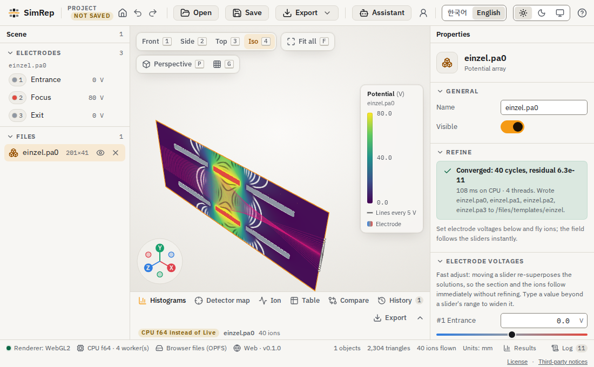
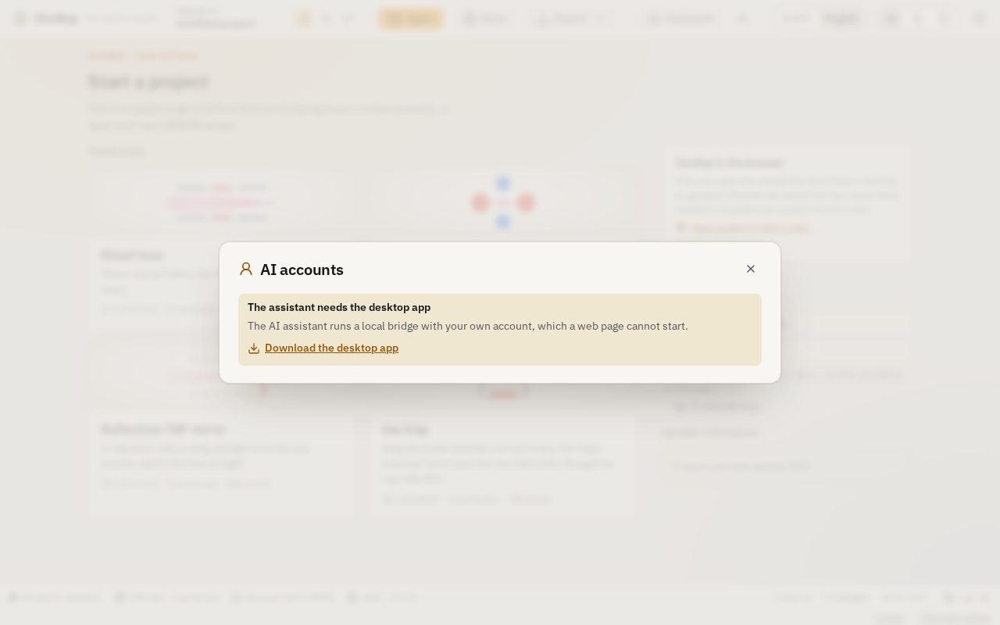
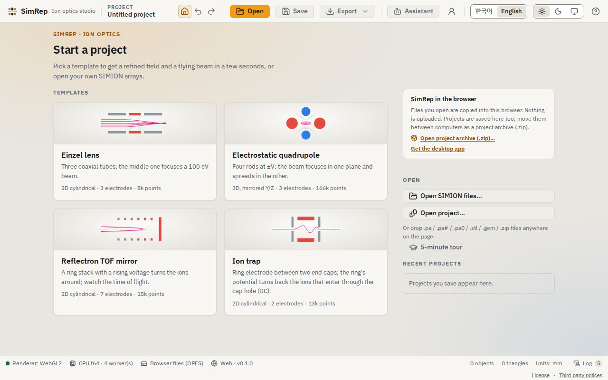
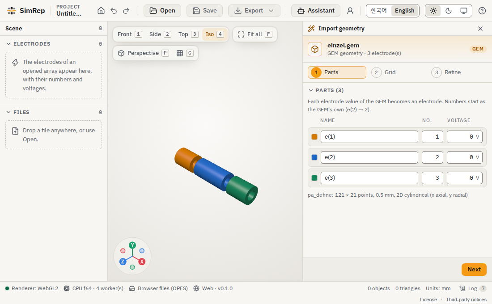
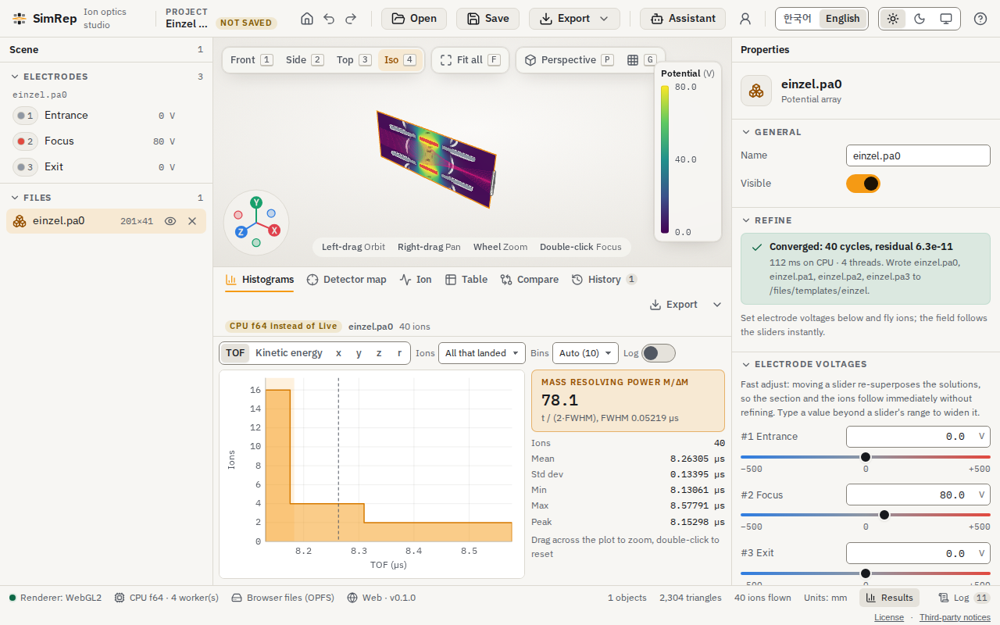
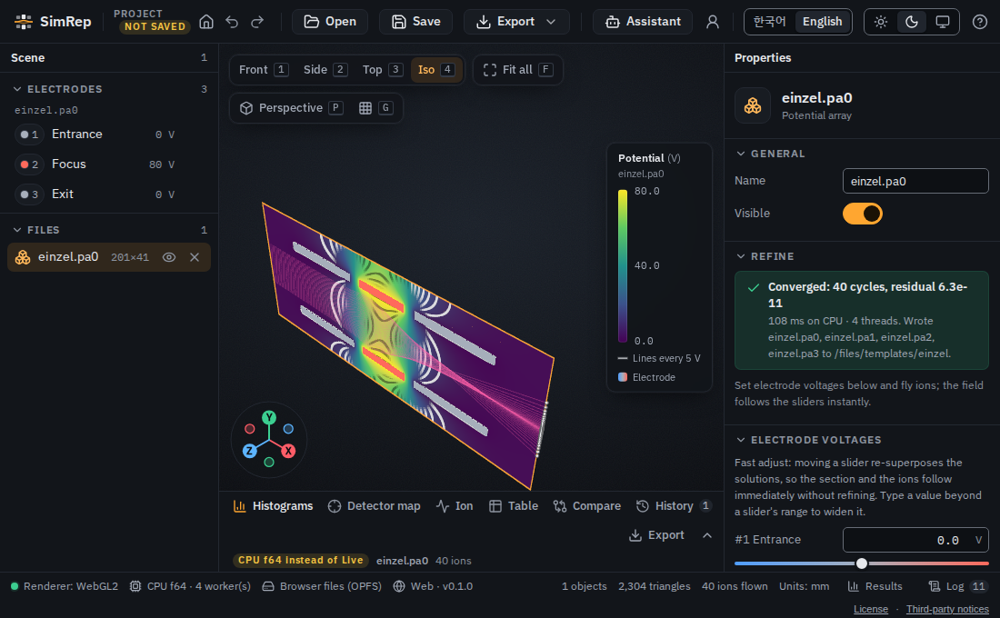
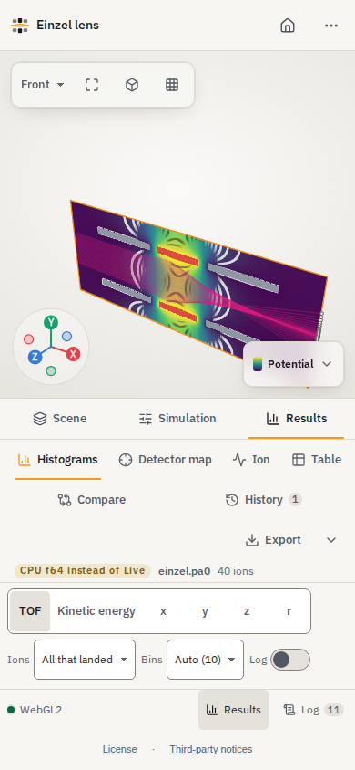

# SimRep-Web

[한국어](README.ko.md) | [SimRep](https://github.com/leeseunguk/SimRep)

SimRep-Web runs the Rust ion-optics core locally in browser WebAssembly workers.
Geometry, electrostatic refinement and particle flight need no computation server.
The browser application wraps the pinned SimRep desktop app sources.



The einzel template after refinement and a 40-ion flight, with the lens fitted to the view.
All screenshots are captured from the built site in headless Chromium using the WebGL2 fallback.

## Features and limits

| Feature | Browser backend | Desktop SimRep |
| --- | --- | --- |
| PA/PA#/PA0 and fast-adjust bases | CPU f64, in-memory files | Native files and Python |
| Templates: einzel, quadrupole, reflectron, trap | Desktop-identical PA# bytes | Native gallery |
| Geometry inspection and aligned/cut-cell building | GEM and supported meshes, SGP1 previews | Also optional CAD |
| IOB workbenches | Bounds and placements, without Lua execution | Native workbench |
| Literal GEM, relative includes, embedded STL | Supported | Also executable Lua |
| STL, OBJ, PLY, 3MF, glTF/GLB | Supported | Also optional STEP/IGES CAD |
| Staircase and exact-source electrostatic refinement | CPU f64, progress/cancellation | CPU and native GPU |
| RK45/Boris, ION/literal FLY2, detector planes | CPU f64 | Full native APIs |
| Uniform B, scalar magnetic PA, coils | CPU flight | Additional magnetic APIs |
| Scientific exports | In-memory PA, mesh, VTI/VTS, CSV/VTP | Native files |
| Multicore CPU | Optional Rayon, up to four workers, isolation required; WebKit defaults to one | Native Rayon |
| 3D view | WebGPU when available, WebGL2 fallback | Native GPU |
| GPU compute | Gated off in the application | Native GPU |
| Executable Lua, CAD, coupled space charge, gas collisions, native filesystem/AI | Not exposed | Desktop APIs |

GPU compute remains gated off until simrep-fly exposes a public field export for
frontend packing. The experimental WebGPU API has f32 kernels; its outer solver
iterate and residual remain CPU f64 (`mixed-f32-f64`). The CPU IPC worker does
not select GPU compute. See [GPU API](docs/webgpu.md) and
[CPU contract](docs/web-contract.md). Trigonometric mesh/revolved-grid exports
can differ by two ULPs between native and wasm; strict OBJ byte identity remains
a documented exception.



Unavailable desktop-only features explain their limits instead of requesting credentials.

### Templates, geometry and results



Start with a template or open local files; the status bar reports actual workers and storage.



A real `einzel.gem` file in the geometry wizard, before grid building and refinement.



Inspect flight distributions and statistics alongside the simulated trajectories.



The same browser workflow in the dark theme.

## Browser support

| Browser | Computation and UI | 3D view | Verification scope |
| --- | --- | --- | --- |
| Chrome/Edge | CPU WebAssembly, up to four workers | WebGPU or WebGL2 | Chromium automation, including WebGPU disabled; Edge not separately tested |
| Safari | CPU WebAssembly, one worker by default | WebGPU or WebGL2 | WebKit tested on Linux WebKitGTK, not real Safari |
| Firefox | CPU WebAssembly | WebGPU or WebGL2 | Not tested in this release |

The 3D view uses WebGPU when available and falls back to WebGL2. The status bar
reports `Renderer: WebGPU` or `Renderer: WebGL2`; an unavailable-view card appears
only when neither API works. Availability depends on device and browser policy;
WebGPU also requires a secure context. Linux WebKitGTK results must not be
interpreted as real Safari platform verification. WebKit defaults to the serial
package because nested threaded module-worker loading intermittently stalls at
startup or reload. Explicit thread requests remain experimental there; the
supported WebKit path uses one CPU f64 worker and IndexedDB storage.

The pinned UI provides phone/tablet layouts and touch orbit, pan and pinch zoom.
The browser E2E suite includes a 390x844 real-worker einzel flight, requiring the
canvas to occupy at least 90% of the width with no document/body horizontal scroll.



The real einzel flight at phone width, with the Scene, Simulation and Results tabs.

## Layout and build

```text
simrep/                 pinned SimRep submodule
crates/simrep-wasm/      browser computation wrapper
app/                    desktop command adapter
web/                    browser UI, IPC worker and end-to-end tests
scripts/                reproducible build entry points
tests/                  native/wasm identity and Chromium harnesses
docs/                   contracts, release instructions and limitations
```

```sh
git clone --recurse-submodules <repository-url>
cd <checkout>
bash scripts/build.sh
```

Install Rust through rustup and Node.js with npm first. Serial Rust is pinned to
1.95.0 and Node.js to 24.14.1. The script installs the wasm32 target, pins
wasm-bindgen-cli 0.2.129, builds serial and threaded packages, and builds a clean
root `dist/`. Threaded wasm uses nightly-2025-11-15. The submodule is pinned to
`2705fec` (responsive layouts/touch, WebGL2 fallback, accessibility and UI polish, Astra review fixes).
`SIMREP_APP_SRC` overrides the default `simrep/app/src` for development; release
builds require the clean gitlink and reset retained development links.
See [RELEASE.md](docs/RELEASE.md) for prerequisites, pin updates and static hosting.

## Verification and hosting

Use HTTPS or localhost. Multicore requires COOP `same-origin` and COEP
`require-corp`. Without isolation/SharedArrayBuffer, the serial package runs one
worker and reports the fallback. Check actual rather than requested worker count.
The shipped coi-serviceworker supports isolation on hosts without custom headers.
The site also ships CSP headers and complete root/third-party licenses; configure
these headers on the deployment host as described in the release instructions.

```sh
cargo build --manifest-path simrep/Cargo.toml --locked --release -p simrep-cli
bash scripts/build-wasm.sh nodejs
export SIMREP_CORE="$PWD/simrep"
export SIMREP_BIN="$PWD/simrep/target/release/simrep"
export SIMREP_APP_MODULES="$PWD/web/node_modules"
node tests/pa-identity.mjs
node tests/geometry-identity-node.mjs
node tests/flight-identity-node.mjs
node tests/flight-physics.mjs
node tests/einzel-browser.mjs
cargo build -p simrep-wasm --example desktop-reference
node tests/desktop-commands.mjs
(cd web && npm run typecheck && npm test && npm run e2e -- --project=chromium --project=webkit)
```

Install browsers with `(cd web && npx playwright install chromium webkit)`.
On a Linux host using an extracted WebKit dependency bundle, select its browser
and library directories explicitly (replace the example directories):

```sh
export PLAYWRIGHT_BROWSERS_PATH=/path/to/playwright-browsers
export PLAYWRIGHT_SKIP_VALIDATE_HOST_REQUIREMENTS=1
export LD_LIBRARY_PATH=/path/to/webkit-root/usr/lib/x86_64-linux-gnu
(cd web && npm run e2e -- --project=webkit)
```

Skipping host validation does not install missing libraries. Harnesses use real
wasm workers and capture native bytes, action/network logs and screenshots under
ignored `evidence/`. Frontend Playwright tests exercise the actual React UI;
backend harness results alone do not establish product UI behavior.
Historical findings are in [verification](docs/integration-verification.md).

## License

PolyForm Noncommercial 1.0.0; see [LICENSE](LICENSE). Dependency licenses remain
their own; see [THIRD_PARTY_NOTICES.md](THIRD_PARTY_NOTICES.md).
